<div align="center">



# TULA · तुला

**Before an AI fines someone, it should weigh the evidence.**

[**Live lab**](https://copyninja07-07.github.io/tula/#lab) &nbsp;·&nbsp; [**Toll desk demo**](https://copyninja07-07.github.io/tula/demo/) &nbsp;·&nbsp; [**Whitepaper**](docs/WHITEPAPER.md) &nbsp;·&nbsp; [**Every number**](experiments/results/)

<sub>Meta Global AI Developer Hackathon 2026 · Indie track · built solo on open Meta models: <b>SAM 3.1</b> and <b>Muse Glimmer 30B</b></sub>

</div>

---

### The charge sheet

India's new barrier-free tolls bill a car from a photo. No barrier, no person checking. A misread plate becomes an e-notice for somebody else, and the fee doubles after 72 hours. Systems like this already bill the wrong people: a New York audit found about 36,000 wrong charges at one exit in three weeks.

Today's billers trust the FASTag, else one confidence threshold. **Nobody can tell a driver how often an innocent car gets charged**, in fog, at night, or when someone clones a plate.

TULA is the layer between the camera and the bill. For every passage it decides **charge**, **hold** or **send to a human**, and it states, per group of traffic, the wrong-charge rate it will not exceed.

---

### How a passage is weighed


| Step | What runs | Why it is there |
|---|---|---|
| **Find** | Meta **SAM 3.1**, text prompts `"license plate"` and `"vehicle"` (MLX, on a 16 GB MacBook) | Found the plate in 247 / 248 foggy photos; the detector used before found 207 |
| **Read, twice, blind** | Reader A: an open-source plate OCR on the crop. Reader B: Meta **Muse Glimmer 30B** on the whole photo (official 4-bit GGUF, llama.cpp, two free Kaggle T4s) | Neither sees the other's answer, so agreement is evidence and not an echo. Glimmer also reports make, colour and type, which a plate alone cannot |
| **Check** | Plain code compares both reads with the FASTag and the registered vehicle | Swapped tags, cloned plates and wrong toll classes show up as contradictions |
| **Score** | A logistic model turns the contradictions into one doubt score `s`, fitted on its own split | A better score buys automation; it never buys safety |
| **Decide** | Conformal risk control picks a cut-off `τ_g` per group `g` from labelled calibration passages | This is where the promise comes from |
| **Explain** | A deterministic evidence note, written by code, never by a model | A reviewer or a driver can check every sentence |

**The rule.** For each group, with `n_g` calibration passages and `L_i(τ) = 1[s_i ≤ τ] · wrong_i`:

$$
\tau_g \;=\; \max\Big\{\tau \;:\; \tfrac{n_g}{n_g+1}\,\widehat{L}_g(\tau) + \tfrac{1}{n_g+1} \;\le\; \alpha \Big\}
\quad\Longrightarrow\quad
\mathbb{E}\big[\text{wrong-charge rate}_g\big] \le \alpha
$$

(Angelopoulos et al., *Conformal Risk Control*, 2022.) A group with too few passages to pass even at `τ = −∞` gets **no certificate, so no automatic charge**. A second mode swaps the average for a Clopper-Pearson bound, so the promise holds with probability ≥ 90% on each calibration set.

---

### The verdict, on 1,050 real photos



232 clear photos, the **same 232 scenes in fog** (hand-labelled for TULA), and 586 Indian-set photos. Promise `α = 5%` per group. Scenes split 20 / 40 / 40 into fit, calibrate, test; mean of **200 random splits**.

| | Wrong charges | Charged automatically | Clear | Fog | Indian set |
|---|---:|---:|---:|---:|---:|
| Today's biller (trust the tag, else the plate) | 17.0% | 100% | 14.1% | 18.9% | 17.4% |
| One threshold: Glimmer ≥ 90% sure | 6.7% | 52% | **12.2%** ✗ | 0.1% | **7.0%** ✗ |
| One threshold: open OCR ≥ 90% sure | 3.7% | 28% | **8.4%** ✗ | 2.5% | 2.3% |
| Glimmer alone + controller | 4.2% | 85% | 3.5% | 4.0% | 4.5% |
| **TULA** | **4.3%** | **86%** | 3.6% ✓ | 4.0% ✓ | 4.6% ✓ |
| TULA, 90%-confidence mode | 2.5% | 79% | 1.5% | 1.9% | 3.1% |

The finding that matters: **a threshold that is safe in fog is unsafe in clear light.** Muse Glimmer refuses to guess in fog (it said "cannot read" on 55% of foggy photos) and is over-confident when it can see (21 wrong reads at ≥ 90% confidence on clear photos). One global threshold cannot know that. A per-group controller does not need to.

<details>
<summary><b>Reader accuracy</b> (exact plate, against hand labels)</summary>

| Photos | SAM 3.1 found the plate | Open plate OCR | Muse Glimmer 30B | Glimmer said "cannot read" |
|---|---:|---:|---:|---:|
| Clear | 248 / 248 | 70.7% | **90.9%** | 0% |
| Fog, same scenes | 247 / 248 | 14.7% | **37.1%** | 54.7% |
| Indian set | – | 32.4% | **68.0%** | 16.3% |

</details>

<details>
<summary><b>Review budget</b>: what a stricter promise costs in human work</summary>

| Promise | Wrong charges | Charged automatically | Held or reviewed |
|---:|---:|---:|---:|
| 1% | 0.53% | 30% | 70% |
| 2% | 1.28% | 63% | 37% |
| 3% | 2.31% | 78% | 22% |
| 5% | 4.40% | 86% | 14% |
| 10% | 9.57% | 94% | 6% |

</details>

---

### Cross-examination: the red team



The controller is calibrated on honest traffic, then attackers (cloned plates, swapped FASTags) take a share `ε` of it. Theory allows the wrong-charge rate to reach `α + ε`. Measured: TULA uses about a third of that room, at every attack level. **Look-alike clones** (a copied plate on a car of the same make and colour) leave nothing in one photo to catch. They still stay inside the bound, because the bound never assumed they would be caught.

---

### What the scale cannot see

- **The FASTag, registry and attack mix are simulated.** The photos and both models' answers are real. No public data links tags, registrations and bills.
- **Reader A is an open-source plate reader used as a stand-in.** It is not the system any Indian toll operator uses.
- **The two readers fail together more than chance would.** On clear photos both are wrong on 9%, three times what independence predicts, so here TULA is only slightly better than Glimmer alone with the same controller. Independence should be measured, not assumed.
- **20 of the 232 hand labels look like typing slips** (both readers agree on something else). They are [listed](experiments/results/label_suspects.csv) and left unchanged, so every reader is scored against the same labels.
- **The guarantee assumes calibration traffic looks like real traffic.** The [whitepaper](docs/WHITEPAPER.md) (Sections 3.5, 3.7, 7.4) shows where that breaks and how a small random audit, never disputes alone, repairs it.

---

### Reproduce every number

```bash
python3 -m venv .venv && .venv/bin/pip install -r requirements.txt
PYTHONPATH=src .venv/bin/python -m pytest -q                              # 25 offline tests
PYTHONPATH=src .venv/bin/python -m tula.real_bench --alpha 0.05 --splits 200
PYTHONPATH=src .venv/bin/python -m tula.evaluate                          # simulated traffic
```

<details>
<summary><b>Regenerate the model reads, the site and the art</b></summary>

| Step | Command | Runs on |
|---|---|---|
| SAM 3.1 boxes | `tools/run_sam_bundle.py` | Apple Silicon (MLX), ~3 s / photo |
| Open OCR on SAM crops | `tools/reader_a_on_sam.py` | CPU |
| Muse Glimmer reads | `kaggle/glimmer_reader/` → `kaggle kernels push --accelerator NvidiaTeslaT4` | 2× T4, llama.cpp, ~7 h for 1,096 photos |
| Reader comparison | `tools/compare_readers.py` | CPU |
| Live-lab data | `tools/export_lab.py` | CPU |
| Toll-desk data | `tools/make_demo.py` | CPU |
| Animated SVGs | `tools/make_art.py` (drawn from the result files) | CPU |

Run each with `PYTHONPATH=src .venv/bin/python <script>`. The browser lab re-implements `src/tula/crc.py` line for line, so its numbers come from the same rule as the paper.

</details>

<details>
<summary><b>Where things live</b></summary>

```
src/tula/        crc.py (controller) · evidence.py (checks + learned score) · note.py (evidence note)
                 real_bench.py (real photos) · sam_crop.py (SAM 3.1) · reader_a.py · muse.py
                 simulate.py · evaluate.py · audit.py (review budget) · feedback.py (dispute loop)
kaggle/          Muse Glimmer reader for Kaggle GPUs
tools/           one script per pipeline step, plus the site and art builders
experiments/     results/: every number quoted anywhere
data/labels/     hand labels for the foggy photos
docs/            website (index.html, demo/), animated SVGs, whitepaper
tests/           offline tests
```

</details>

### Data

| Source | Use | Licence |
|---|---|---|
| [Foggy-Hazy License Plates](https://data.mendeley.com/datasets/p3jr4555tf) (Mendeley) | 248 foggy photos + clear versions, plate text [hand-labelled for TULA](data/labels/foggy_labels.csv) | CC BY 4.0 |
| [zenitsu09/indian-number-plate](https://huggingface.co/datasets/zenitsu09/indian-number-plate) | Indian plates with text | Not stated by the uploader |
| [sonnetechnology/license-plate-text-recognition-full](https://huggingface.co/datasets/sonnetechnology/license-plate-text-recognition-full) | Vietnamese plates, second country for the OCR check | CC BY 4.0 |

Full photo sets are not redistributed; download them into `data/raw/`. The toll-desk demo shows small thumbnails of 19 CC BY photos, with credit; Indian-set passages are shown without their photos.

### Prior work

Every building block exists already: plate OCR, vision-language plate readers (LP-LLM, BLPR), conformal risk control, deferral to humans under a budget, audit-based error control (Gibbs, Han, Tibshirani and Zrnic, 2026), clone checks against a registry. To our knowledge they have not been combined and measured for toll billing. Section 4 of the [whitepaper](docs/WHITEPAPER.md) says which parts are new and which are not.

<div align="center"><sub>Suryansh Pratap Singh · <a href="https://github.com/CopyNinja07-07">GitHub</a> · <i>tulā</i>, Sanskrit for the balance scale</sub></div>
